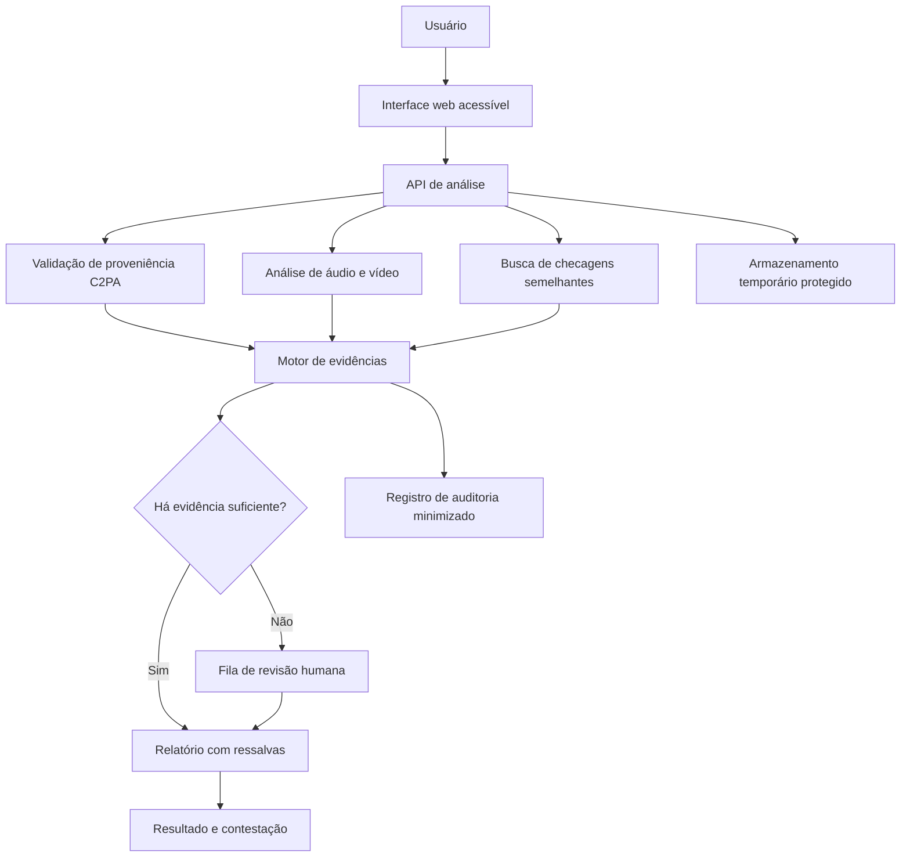
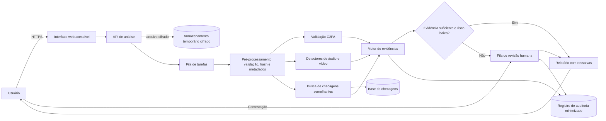

# Dossiê 4: Deepfakes e Proveniência de Conteúdo

## Integrantes

| Nome completo | RGM | GitHub | Área de carreira |
|---|---|---|---|
| Albert dos Santos Mariano| 47857927 | AlbertdosSantosMariano | Engenharia de Dados
| Gabriel Anjos Albuquerque | 48037931 | Nerd8im | Engenharia de Dados
| João Pedro Theodoro de Sousa Andrade| 47863251 | jp-theodoro | Ciência de Dados 
| Petterson Michel Lima Aguilar | 47859792 | PettersonAguilar | Engenharia de Dados
| Samuel Carmoni de Oliveira | 47813733 |carmonisamuel-cloud | Cybersegurança
|---|---|---|---|

### Apresentação do projeto

A evolução da inteligência artificial generativa tornou possível produzir áudios e vídeos sintéticos capazes de simular falas, aparências e comportamentos de pessoas reais. Essa tecnologia apresenta aplicações legítimas, mas também pode ser utilizada para fraudes, manipulação de informações e desinformação.

O Dossiê 4 propõe investigar como identificar conteúdos manipulados e verificar sua origem, considerando limitações tecnológicas, riscos éticos e impactos sociais.

**Recorte proposto:** Verificação de áudios e vídeos de caráter político-eleitoral compartilhados em redes sociais e aplicativos de mensagens no Brasil.

**Justificativa do recorte:** A circulação rápida desses conteúdos pode dificultar a verificação antes que uma informação falsa produza impactos sociais. O problema exige combinar Ciência de Dados, Cibersegurança, Engenharia de Dados, Computação em Nuvem e mecanismos de revisão humana.

**Proposta inicial:** Desenvolver conceitualmente o VerificaBR, uma plataforma de verificação assistida que combina análise de proveniência digital, detecção probabilística de manipulações, comparação com checagens anteriores e revisão humana.

**Pergunta central:**

> É melhor detectar o conteúdo falso ou comprovar a origem do verdadeiro? Como agir quando a tecnologia não consegue determinar a autenticidade com segurança?

## 1. Análise do problema

**Responsável:** Gabriel Anjos Albuquerque

### 1.1 Quem é afetado, onde e quanto?

Os deepfakes podem afetar diferentes grupos sociais, especialmente quando são utilizados para simular declarações, divulgar acontecimentos inexistentes ou manipular a percepção pública.

**Grupos potencialmente afetados:**

- Eleitores expostos a conteúdos políticos manipulados.
- Pessoas idosas e usuários com menor familiaridade digital.
- Jornalistas e profissionais de checagem.
- Pessoas que tiveram imagem ou voz falsificadas.
- Plataformas digitais e aplicativos de mensagens.
- Instituições públicas, incluindo a Justiça Eleitoral.

**Contexto brasileiro:**

Um levantamento de 2026 da Data Privacy Brasil e do Aláfia Lab registrou 413 casos de uso de inteligência artificial em publicações políticas entre janeiro e agosto de 2026, incluindo 336 envolvendo manipulações de imagem ou áudio de pessoas públicas.

Fonte: [Data Privacy Brasil — IA na pré-eleição de 2026](https://www.dataprivacybr.org/documentos/ia-na-pre-eleicao-deepfakes-desinformacao-e-novos-desafios-para-a-integridade-das-eleicoes-de-2026/).

Esses números correspondem ao monitoramento citado, não a uma estimativa de todos os deepfakes existentes no país.

**Dados quantitativos recentes (Brasil, 2024 a 2026):**

| Levantamento | População observada | Principais números |
|---|---|---|
| Observatório IA nas Eleições, da Data Privacy Brasil e do Aláfia Lab ([Folhapress](https://www.bahianoticias.com.br/folha/noticia/409339-lula-foi-alvo-de-1-em-cada-4-conteudos-com-ia-publicados-na-pre-campanha-diz-levantamento); [Agência Brasil](https://www.acessa.com/politica/2026/09/339752-flavio-e-pl-lideram-uso-indevido-de-ia-diz-observatorio.html)) | Publicações políticas com IA identificadas nas redes sociais entre 1º de janeiro e meados de agosto de 2026 | 413 casos (média de 1,8 por dia); 60% classificados como sátira e 40% como desinformação; 81% manipularam imagem ou voz de pessoas públicas; Lula foi alvo de 112 casos e Flávio Bolsonaro de 57; quase dois em cada três conteúdos não informaram o uso de IA |
| VigIA, da Agência Lupa com o laboratório Recod.ai da Unicamp ([Agência Brasil](https://agenciabrasil.ebc.com.br/geral/noticia/2026-10/mesmo-proibidos-deepfakes-tomam-conta-das-redes-antes-da-eleicao)) | Campanha do 1º turno, de 16/08 a 28/09/2026: 1.941 conteúdos político-eleitorais suspeitos coletados, dos quais 972 já analisados e 920 com uso de IA confirmado | 554 deepfakes (60% dos 920); só 371 dos 920 conteúdos (cerca de 40%) estavam rotulados como feitos com IA; 525 deepfakes partiram de perfis que não eram de candidatos ou partidos e 29 de perfis de candidaturas ou legendas |
| *A IA do Nosso Feed*, do Observatório Lupa com a FAAP ([relatório](https://uploads.agencialupa.org/2026/08/IA-do-Nosso-Feed_PDF.pdf)) | 13 estudantes de até 35 anos que monitoraram os próprios feeds (Instagram, Facebook, X, TikTok e WhatsApp) de fevereiro a junho de 2026 | 226 conteúdos suspeitos: 101 (45%) com IA confirmada e 125 sem confirmação; 92 dos 101 confirmados eram vídeos e 40 tratavam de política |
| Panorama da Desinformação, do Observatório Lupa ([relatório](https://www.agencialupa.org/observatorio/2026/02/05/i-panorama-da-desinformacao-no-brasil-padroes-estrategias-e-impacto/), citado no relatório acima) | Conteúdos falsos checados pela Agência Lupa | A presença de IA nesses conteúdos saltou de 4,65% para 25,77% em um ano; pela primeira vez, a desinformação política sintética superou os golpes e fraudes financeiras feitos com IA |
| Aos Fatos, ICL Notícias e Clip, sobre as eleições municipais de 2024 ([Aos Fatos](https://www.aosfatos.org/noticias/acoes-inteligencia-artificial-justica-eleitoral/)) | Decisões publicadas nos Diários da Justiça Eletrônicos dos TREs até o 1º turno (6/10/2024) | Ao menos 159 casos de IA na propaganda eleitoral, 81 deles no Nordeste; vídeos citados nas ações: Instagram (79), WhatsApp (52) e Facebook (18); nos áudios sintéticos, o principal canal de difusão foi o WhatsApp |

**Exemplos documentados no Brasil:**

1. **Fortaleza (CE), 2024: áudio contestado no WhatsApp.** Um áudio atribuído ao candidato a prefeito André Fernandes (PL), em que a voz fala em distribuir dinheiro a pastores e lideranças comunitárias para vencer o segundo turno, circulou em grupos de mensagens, e o candidato afirmou que se tratava de conteúdo sintético. O Comprova pediu a dois peritos forenses que analisassem o material e eles chegaram a conclusões divergentes; a Lupa submeteu o arquivo a três ferramentas de detecção e também obteve resultados diferentes ([Comprova, publicado pelo O Povo](https://www.opovo.com.br/noticias/politica/eleicoes/2024/10/27/amp/analises-de-audio-apontado-por-andre-fernandes-como-deepfake-tem-resultados-divergentes.html)). O Aos Fatos apurou que o candidato não havia comprovado nem que o áudio foi gerado por IA nem que partiu da campanha adversária ([Aos Fatos](https://www.aosfatos.org/noticias/andre-fernandes-nao-comprovou-que-audio-foi-gerado-ia/)), e o TRE-CE manteve a condenação dele por propaganda irregular em razão da acusação ([O Povo](https://mais.opovo.com.br/colunistas/vertical/2024/11/29/tre-condena-andre-por-acusar-evandro-por-audio-falso-durante-campanha.html)). É um caso real em que a autenticidade de um áudio político não foi determinada com segurança nem por peritos nem por ferramentas.
2. **Andorinha (BA), 2024: voz de uma pessoa falecida.** Em um evento partidário, a então pré-candidata a prefeita exibiu um áudio gerado por IA que simulava a voz do pai, ex-prefeito morto em 2022. A Justiça Eleitoral removeu a publicação em liminar, mas o processo foi encerrado sem julgamento do mérito, porque o partido autor da ação não teve a legitimidade reconhecida. A resolução do TSE veda a simulação de pessoas vivas, falecidas ou fictícias ([Aos Fatos](https://www.aosfatos.org/noticias/acoes-inteligencia-artificial-justica-eleitoral/)).
3. **São Gonçalo do Amarante (CE), 2024: telejornal falso no WhatsApp.** Um vídeo simulou uma reportagem de TV local, com diálogo alterado entre âncora e repórter, para associar o então prefeito e candidato à reeleição a um crime contra um candidato a vereador. A ação para identificar o autor foi indeferida por questões processuais, sem análise do mérito ([Aos Fatos](https://www.aosfatos.org/noticias/acoes-inteligencia-artificial-justica-eleitoral/)). Em 2026, o VigIA voltou a registrar entre as deepfakes mais recorrentes vídeos em que jornalistas anunciam notícias inventadas e celebridades declaram apoio falso a candidatos ([Agência Brasil](https://agenciabrasil.ebc.com.br/geral/noticia/2026-10/mesmo-proibidos-deepfakes-tomam-conta-das-redes-antes-da-eleicao)).
4. **Pré-campanha de 2026: falsas pesquisas e pedidos de voto sintéticos.** O relatório da Lupa e da FAAP registrou um deepfake do deputado Nikolas Ferreira divulgando uma pesquisa falsa que colocava Flávio Bolsonaro à frente de Lula no 1º turno, deepfakes de Jair Bolsonaro pedindo apoio à candidatura de Flávio e vídeos de Lula prometendo medidas impopulares, como cortar aposentadorias ([relatório](https://uploads.agencialupa.org/2026/08/IA-do-Nosso-Feed_PDF.pdf)). A disputa também chegou ao TSE: a Federação Brasil da Esperança (PT, PCdoB e PV) pediu a retirada de postagens de 32 perfis, que somam 1,4 milhão de seguidores e 23,8 mil publicações ([Agência Brasil, via Rondônia Dinâmica](https://www.rondoniadinamica.com/noticias/2026/07/federacao-do-pt-recorre-ao-tse-para-retirar-postagens-de-deep-fake,250534.shtml)), e alegou a existência de uma rede articulada por parlamentares aliados a Flávio Bolsonaro ([JB](https://www.jb.com.br/brasil/justica/2026/07/amp/1060450-pt-pcdob-e-pv-pedem-ao-tse-remocao-de-posts-de-ia-contra-lula.html)); trata-se de alegação da federação, não de fato julgado. Flávio Bolsonaro foi o segundo mais retratado, depois de Lula, no Observatório IA nas Eleições (57 casos) e no VigIA (190 publicações). Em outra apuração, o Aos Fatos revelou uma rede de 255 perfis que publicou ou coassinou 1.204 posts com 58 milhões de visualizações em um mês, e uma das principais contas foi suspensa por determinação do TSE com base no relatório ([Aos Fatos](https://www.aosfatos.org/noticias/ia-ultrarrealista-whatsapp-desinformacao-moldou-eleicoes/)).

**População observada e limitações dos levantamentos:**

- Os levantamentos não medem a mesma coisa e não são comparáveis entre si. A própria Lupa avisa que seus resultados não são diretamente comparáveis aos anteriores, por diferenças de amostragem e metodologia, e distingue *deepfake* (simulação convincente de uma pessoa) de *conteúdo sintético* em geral ([relatório](https://uploads.agencialupa.org/2026/08/IA-do-Nosso-Feed_PDF.pdf)).
- O experimento *A IA do Nosso Feed* parte de feeds de 13 voluntários com até 35 anos, sem amostra estatística representativa; portanto, não observa pessoas idosas, que fazem parte do público mais vulnerável do nosso recorte. O relatório declara que não pretende estimar a prevalência de conteúdos sintéticos.
- O VigIA conta o que foi coletado e confirmado: quando o relatório saiu, 972 dos 1.941 conteúdos suspeitos haviam sido analisados (cerca de metade), e a confirmação depende de três ferramentas de detecção seguidas de revisão dos pesquisadores ([Agência Brasil](https://agenciabrasil.ebc.com.br/geral/noticia/2026-10/mesmo-proibidos-deepfakes-tomam-conta-das-redes-antes-da-eleicao)). Os números são, portanto, um piso, e herdam os limites dos detectores (seção 1.2).
- O levantamento do Aos Fatos de 2024 só enxerga o que chegou à Justiça Eleitoral, por busca de palavras-chave nos diários dos TREs, e analisa as petições iniciais sem considerar se o uso de IA foi reconhecido pelos juízes. Há subnotificação: advogados de cidades pequenas tiveram dificuldade de coletar e preservar provas, o que prejudicou a tramitação de várias ações ([Aos Fatos](https://www.aosfatos.org/noticias/acoes-inteligencia-artificial-justica-eleitoral/)).
- Inferência do grupo: monitoramentos de publicações abertas e processos judiciais enxergam pouco do que circula em conversas e grupos privados de mensageria, onde só aparecem os casos que alguém decide denunciar.

**Consequências sociais, econômicas e institucionais:**

- **Sociais.** A mistura de humor e desinformação dificulta a leitura: 60% dos casos do Observatório IA nas Eleições eram sátira, e a Lupa alerta que peças humorísticas fora de contexto podem ser tomadas por registros reais. Há também excesso de confiança: pesquisa da Indexa indica que 72% dos brasileiros acreditam reconhecer conteúdos manipulados por IA ([Congresso em Foco](https://www.congressoemfoco.com.br/conteudo/121736/deepfakes-a-ameaca-que-ja-chegou-as-eleicoes-de-2026)), mas, no experimento da Lupa, os comentários mostraram que parte do público não percebeu sinais visíveis de manipulação, como sincronia labial imperfeita, e mesmo as ferramentas de detecção divergiram entre si.
- **Institucionais.** A responsabilização é difícil: 525 dos 554 deepfakes do VigIA não vieram de candidaturas, e a pesquisadora responsável afirma que a Justiça precisaria trabalhar com as plataformas para identificar autores anônimos ([Agência Brasil](https://agenciabrasil.ebc.com.br/geral/noticia/2026-10/mesmo-proibidos-deepfakes-tomam-conta-das-redes-antes-da-eleicao)). As regras existem (Resolução TSE nº 23.755/2026, que exige identificação do uso de IA e restringe conteúdos sintéticos de áudio e vídeo que favoreçam ou prejudiquem candidaturas, conforme o [Correio Braziliense](https://www.correiobraziliense.com.br/politica/2026/09/7491361-tse-comeca-a-julgar-acao-sobre-uso-de-deepfake-na-eleicao.html)), com sanções que vão de multas de R$ 5 mil a R$ 30 mil até a cassação do registro ou do mandato ([O Povo](https://www.opovo.com.br/noticias/politica/eleicoes/2026/07/25/ia-nas-eleicoes-2026-saiba-o-que-e-proibido-prazos-e-multas.html)), mas só 371 dos 920 conteúdos do VigIA estavam rotulados. O caso de Fortaleza mostra ainda o risco inverso: a alegação de "deepfake" pode ser usada como defesa, mesmo sem comprovação.
- **Econômicas.** Até a virada registrada pela Lupa, os conteúdos sintéticos ligados a golpes e fraudes financeiras superavam os de desinformação política nas checagens, o que indica prejuízo direto a vítimas desses golpes. Há ainda um custo de verificação: o VigIA precisa de três ferramentas e de pesquisadores para confirmar cada caso, e metade dos casos coletados ainda estava sem análise quando o relatório foi publicado.

**Relação com o recorte escolhido:** o problema se concentra onde o recorte atua. O vídeo é o formato predominante nos conteúdos sintéticos confirmados pela Lupa (92 dos 101) e, no Aos Fatos de 2024, o WhatsApp foi o principal canal dos áudios sintéticos levados à Justiça. Em 2026, segundo o Digital News Report do Reuters Institute, 46% dos brasileiros usam o WhatsApp para se informar, ao lado do Instagram (49%) e do YouTube (42%) ([Nosso Meio](https://nossomeio.com.br/cnn-brasil-lidera-ranking-de-confianca-entre-marcas-jornalisticas-no-brasil/)). A rapidez de circulação em redes e aplicativos de mensagens, somada à dificuldade de determinar a autenticidade (casos como o de Fortaleza), é o que justifica uma ferramenta de verificação assistida que trabalhe com evidências e admita o resultado inconclusivo.

### 1.2 Quais são as causas técnicas do problema?

A produção de conteúdos sintéticos tornou-se mais acessível com o avanço dos modelos generativos de áudio e vídeo.

Entre as principais dificuldades técnicas estão:

1. Modelos de síntese de voz e imagem cada vez mais convincentes.
2. Compartilhamento rápido de conteúdos sem verificação prévia.
3. Perda de metadados durante compressão, edição e reenvio.
4. Ausência de adoção universal de padrões de proveniência.
5. Limitações de generalização dos detectores automáticos.
6. Possíveis diferenças de desempenho entre sotaques, idiomas e condições de gravação.

Um estudo denominado *Deepfake-Eval-2024*, divulgado em 2025, mostrou que o desempenho de detectores pode cair consideravelmente quando são avaliados em conteúdos reais encontrados na internet, em comparação com bases acadêmicas tradicionais.

Fonte: https://doi.org/10.48550/arXiv.2503.02857

**Como funcionam deepfakes de voz e vídeo.** Na voz, o método mais usado hoje é a síntese de fala *zero-shot*: o modelo de texto para fala recebe uma gravação curta de referência e gera frases novas com a voz da pessoa, sem ser treinado especificamente com ela. Foi assim que o conjunto BRSpeech-DF foi construído, com cinco modelos zero-shot condicionados à voz de cada falante real ([Filho et al., EMNLP 2025](https://aclanthology.org/2025.emnlp-main.1780/)). O benchmark Deepfake-Eval-2024 cita ainda a conversão de voz e, no vídeo, a troca de rosto (*face swap*), a sincronização labial (*lipsync*, que altera a boca para acompanhar outro áudio) e modelos de difusão ([Chandra et al., 2025](https://doi.org/10.48550/arXiv.2503.02857)). Depois de gerado, o conteúdo pode receber disfarces: em um áudio atribuído a Alexandre de Moraes e apontado como sintético pelo Comprova, um especialista observou que um corte simulando o afastamento do microfone dava tom mais genuíno e que uma música contínua escondia pontos que poderiam revelar a síntese ([Comprova](https://sbtnews.sbt.com.br/noticia/comprova/audio-de-moraes-sobre-proibir-linguajar-evangelico-foi-feito-por-ia)).

**Falsos positivos e falsos negativos.** Um detector costuma devolver uma pontuação de "chance de ser sintético", e um limiar transforma essa pontuação em rótulo. Falso positivo é o conteúdo autêntico apontado como manipulado; falso negativo é o conteúdo sintético considerado autêntico. Mudar o limiar troca um erro pelo outro, e nenhum limiar elimina os dois. No experimento da Lupa e da FAAP, um vídeo com Lula e Jair Bolsonaro dançando foi classificado como provavelmente autêntico por duas ferramentas (Deepware e Undetectable AI), enquanto o TruthScan indicou 89% de probabilidade de ser sintético e o Gemini, com SynthID, reconheceu o deepfake ([relatório](https://uploads.agencialupa.org/2026/08/IA-do-Nosso-Feed_PDF.pdf)). Mesmo uma probabilidade alta é uma estimativa estatística: o Comprova relatou 99,2% de chance de geração artificial em um áudio falso atribuído ao candidato Renan Santos, obtida na ferramenta Hive Moderation ([Canaltech](https://canaltech.com.br/inteligencia-artificial/deepfakes-como-saber-se-um-video-de-candidato-e-verdadeiro/)). Na prática eleitoral, o falso positivo pode desacreditar uma gravação verdadeira e o falso negativo deixa uma falsificação circular com aparência de checada. A própria TruthScan informou à Lupa que pontuações perto do limiar de 50 (em escala de 0 a 100) devem ser lidas como incertas e analisadas junto com outros sinais.

**Por que um detector pode falhar em situações reais.**

- **Mudança de distribuição.** O Deepfake-Eval-2024 reúne 45 horas de vídeo, 56,5 horas de áudio e 1.975 imagens sinalizadas por usuários em 2024, de 88 sites e 52 idiomas. Nesses dados, a AUC dos detectores abertos caiu em média 50% no vídeo, 48% no áudio e 45% na imagem em relação aos benchmarks acadêmicos; a AUC máxima entre os modelos abertos foi 0,58, e vários ficaram perto de 0,5, equivalente a chute. Modelos comerciais e modelos ajustados com dados reais foram melhores, mas ainda abaixo dos analistas forenses ([Chandra et al., 2025](https://doi.org/10.48550/arXiv.2503.02857)).
- **Treinamento defasado.** A Deepware respondeu à Lupa que os dados de treinamento do seu modelo terminam em 2020, porque o foco da empresa passou para a geração de conteúdo ([relatório](https://uploads.agencialupa.org/2026/08/IA-do-Nosso-Feed_PDF.pdf)).
- **Cobertura restrita a um gerador.** O SynthID só detecta conteúdos feitos por ferramentas do Google, segundo o mesmo relatório.
- **Critérios diferentes.** A TruthScan explicou que as ferramentas diferem em dados de treino, geradores-alvo e limiares, e por isso divergências são esperadas. Na Lupa, 20 casos tiveram diagnósticos conflitantes e 125 dos 226 conteúdos suspeitos (55%) continuaram sem confirmação.
- **Métricas de fornecedor não garantem desempenho real.** A TruthScan declara 99,0% de acurácia em mais de 200 mil previsões, mas em seus próprios testes; o benchmark independente acima mostra que resultados de laboratório não se transferem automaticamente para conteúdo circulando nas redes.

**Como compressão e reenvio afetam a análise.** Para os detectores, a TruthScan informou que seus modelos toleram compressão simples, mas recompressão intensa ou repetida, capturas de tela e a forte compressão de aplicativos de mensagens e redes sociais reduzem a qualidade dos sinais dos quais todos os detectores dependem; e, quando uma imagem é muito reduzida e depois ampliada, os artefatos de geração se perdem e nenhum detector os recupera ([relatório da Lupa](https://uploads.agencialupa.org/2026/08/IA-do-Nosso-Feed_PDF.pdf)). Para a proveniência, o efeito é ainda mais duro: no C2PA, a assinatura "dura" (*hard binding*) é calculada sobre os bytes do arquivo, então qualquer recodificação a invalida ([especificação C2PA 2.2](https://spec.c2pa.org/specifications/specifications/2.2/index.html); [análise técnica](https://www.softwareseni.com/c2pa-watermarking-fingerprinting-technical-comparison-ai-content-disclosure/)). Em teste do Washington Post, um vídeo gerado no Sora com Content Credentials foi postado em oito plataformas e nenhuma manteve os dados ([reprodução na AI Incident Database](https://incidentdatabase.ai/reports/6301)). A especificação prevê o *soft binding*, uma marca d'água ou impressão digital que permite localizar o manifesto original em um repositório mesmo após a remoção dos metadados ([C2PA](https://c2pa.org/specifications/specifications/2.2/softbinding/Decoupled.html)), mas isso só funciona se o criador marcou o conteúdo antes, e essas marcas podem sofrer ataques de colisão ([análise técnica](https://www.softwareseni.com/c2pa-watermarking-fingerprinting-technical-comparison-ai-content-disclosure/)). Quando as credenciais não aparecem, isso indica apenas que nunca foram anexadas ou foram removidas, e não que o conteúdo seja falso. Consequência para o VerificaBR: registrar indicadores de qualidade do arquivo, pedir o original sempre que possível e reduzir automaticamente a confiança quando o sinal estiver degradado.

**Riscos para conteúdos em português brasileiro.**

- **Pouca base de referência.** O BRSpeech-DF, de 2025, é o primeiro conjunto público para detecção de deepfakes de áudio em português, com 458.411 arquivos (cerca de 160 horas de fala natural e 823 horas de fala sintética) de 62 falantes reais, em português do Brasil e de Portugal. Os autores afirmam que a pesquisa em detecção se concentra no inglês, o que cria viés linguístico ([Filho et al., 2025](https://aclanthology.org/2025.emnlp-main.1780/)). Hipótese do grupo, a testar: detectores treinados sobretudo em inglês podem generalizar mal para o português e para sotaques regionais, e 62 falantes cobrem apenas parte da diversidade do país.
- **Menos exemplos checados.** No mapeamento global da Lupa, foram 427 casos de desinformação com IA em inglês, 198 em espanhol e 111 em português ([Agência Brasil](https://agenciabrasil.ebc.com.br/geral/noticia/2026-04/ia-acelera-desinformacao-e-ameaca-democracias-alerta-pesquisa)); por inferência, há menos material rotulado em português para treinar e avaliar detectores.
- **Canal de circulação.** Áudios sintéticos levados à Justiça em 2024 circularam principalmente pelo WhatsApp ([Aos Fatos](https://www.aosfatos.org/noticias/acoes-inteligencia-artificial-justica-eleitoral/)), onde o reenvio e a recompressão degradam os sinais descritos acima.
- **Medida necessária.** Antes de qualquer piloto, avaliar o desempenho por sotaque, região, gênero, qualidade de gravação e tipo de dispositivo, em linha com a matriz de riscos da seção 3 e as métricas da seção 6.

### 1.3 O que já existe e por que não basta?

| Solução existente | O que faz | Limitação a investigar |
|---|---|---|
| Detectores de deepfake | Identificam sinais estatísticos de manipulação | Podem errar em conteúdos não vistos no treinamento |
| C2PA / Content Credentials | Permite verificar informações assinadas sobre origem e histórico de arquivos | Nem todo conteúdo possui credenciais; sua ausência não comprova falsidade |
| Agência Lupa | Realiza checagens jornalísticas | A análise humana exige tempo e recursos |
| Aos Fatos | Investiga informações e conteúdos suspeitos | Não cobre necessariamente todo conteúdo que circula |
| Sistemas de moderação | Aplicam políticas das plataformas | Podem apresentar falta de transparência ou decisões contestáveis |

**Comparação com evidências:**

| Iniciativa | Como atua | Por que não basta para o recorte |
|---|---|---|
| Detectores automáticos (Deepware, TruthScan, Hive, Gemini/SynthID) | Estimam a probabilidade de o conteúdo ser sintético; o VigIA usa três ferramentas e depois a revisão de pesquisadores ([Agência Brasil](https://agenciabrasil.ebc.com.br/geral/noticia/2026-10/mesmo-proibidos-deepfakes-tomam-conta-das-redes-antes-da-eleicao)) | Diagnósticos conflitantes em 20 casos e 125 de 226 conteúdos sem confirmação; a Deepware treinou até 2020 e o SynthID só cobre conteúdos do Google; a maioria das ferramentas só oferece versão paga ou limita o uso gratuito ([Lupa](https://uploads.agencialupa.org/2026/08/IA-do-Nosso-Feed_PDF.pdf)) |
| C2PA / Content Credentials | Assina a origem e o histórico de edições; a versão 2.2 prevê *soft binding* para recuperar manifestos removidos ([C2PA](https://c2pa.org/specifications/specifications/2.2/softbinding/Decoupled.html)) | Em teste do Washington Post, nenhuma das oito plataformas manteve as credenciais ([AI Incident Database](https://incidentdatabase.ai/reports/6301)); só protege o que foi assinado na origem, e a ausência de credenciais não prova falsidade |
| VigIA, da Lupa com o Recod.ai | Monitoramento sistemático de conteúdos político-eleitorais: 1.941 suspeitos coletados e 920 com IA confirmada | Quando o relatório saiu, só 972 dos 1.941 haviam sido analisados: a análise humana é o gargalo ([Agência Brasil](https://agenciabrasil.ebc.com.br/geral/noticia/2026-10/mesmo-proibidos-deepfakes-tomam-conta-das-redes-antes-da-eleicao)) |
| Comprova | Rede de 42 veículos de imprensa que verifica conteúdos suspeitos ([SBT News](https://sbtnews.sbt.com.br/noticia/comprova/confira-as-checagens-do-comprova-sobre-as-eleicoes-municipais-em-quatro-capitais)); em 2026, oferece apoio a jornalistas pelo WhatsApp, inclusive na checagem de conteúdo gerado por IA ([Correio Braziliense](https://www.correiobraziliense.com.br/holofote/2026/09/7507556-comprova-lanca-projeto-para-as-eleicoes-com-servico-de-apoio-a-jornalistas-no-combate-a-desinformacao.html)) | Atende sobretudo jornalistas e conteúdos que ganham escala; no caso de Fortaleza, nem os peritos concordaram ([O Povo](https://www.opovo.com.br/noticias/politica/eleicoes/2024/10/27/amp/analises-de-audio-apontado-por-andre-fernandes-como-deepfake-tem-resultados-divergentes.html)) |
| TSE e Google (Detecção por Semelhanças, do YouTube) | Candidatos cadastrados localizam vídeos que usam sua aparência; o cadastro exige documento oficial e selfie ([Diario de Pernambuco](https://www.diariodepernambuco.com.br/politica/2026/08/11722378-tse-e-google-lancam-ferramenta-para-candidatos-identificarem-deepfakes-no-youtube.html)) | Vale só para o YouTube e só para quem se cadastra; casos em outras plataformas seguem as denúncias e regras de cada serviço ([Correio Braziliense](https://www.correiobraziliense.com.br/brasil/2026/08/amp/7488108-candidatos-poderao-rastrear-deepfakes-com-nova-ferramenta-do-youtube.html)), e o eleitor comum e o WhatsApp ficam de fora |
| Rotulagem e moderação das plataformas, com as regras do TSE | A Resolução 23.755/2026 exige identificação do uso de IA e restringe deepfakes na propaganda ([Correio Braziliense](https://www.correiobraziliense.com.br/politica/2026/09/7491361-tse-comeca-a-julgar-acao-sobre-uso-de-deepfake-na-eleicao.html)) | Só 371 de 920 conteúdos do VigIA estavam rotulados; no teste do Washington Post, apenas uma de oito plataformas sinalizou o vídeo, de forma discreta ([resumo do teste](https://fredritchin.substack.com/p/major-platforms-are-not-labeling)); uma auditoria do Indicator achou que cinco plataformas rotularam corretamente cerca de 33% dos conteúdos de IA testados ([Medianama](https://www.medianama.com/2025/11/223-audit-social-media-google-meta-ai-labelling/)) |

**Por que nenhuma resolve integralmente o recorte.** Cada iniciativa cobre uma camada e deixa as outras descobertas. A detecção é probabilística e inconsistente entre ferramentas; a proveniência depende de assinatura na origem e de sobreviver ao reenvio; a checagem jornalística é precisa, mas lenta e limitada em volume; as ferramentas das plataformas e do TSE só alcançam os próprios serviços ou os candidatos. O recorte (áudio e vídeo político circulando em redes e mensageria) exige as três camadas juntas e acessíveis ao cidadão, e hoje não há um fluxo único que as una. O próprio VigIA mostra a assimetria: a maior parte dos deepfakes partiu de usuários comuns, mas a maioria das ferramentas de detecção é paga ou limitada para o público em geral ([Lupa](https://uploads.agencialupa.org/2026/08/IA-do-Nosso-Feed_PDF.pdf)).

**Oportunidade de melhoria.**

1. Reunir proveniência, sinais técnicos e checagens existentes em um único relatório, com a incerteza explícita.
2. Reaproveitar checagens já feitas antes de gastar processamento e tempo humano. As checagens estão dispersas entre várias organizações (Lupa, Aos Fatos, UOL Confere, AFP Checamos, Fato ou Fake, Estadão Verifica, E-farsas e Boatos.org, segundo a [Abraji](https://abraji.org.br/noticias/em-medida-contra-a-desinformacao-eleitoral-projeto-comprova-podera-ser-acessado-sem-cobranca-de-dados-do-celular)) e a marcação *ClaimReview* permite publicá-las de forma estruturada ([Google](https://developers.google.com/search/docs/data-types/factcheck)), mas a API de busca do Google cobre apenas afirmações por texto e por imagem ([Google](https://developers.google.com/fact-check/tools/api/reference/rpc)); não há busca por áudio ou vídeo, lacuna que o VerificaBR pode preencher com transcrição e impressão digital de mídia.
3. Encaminhar à revisão humana apenas os casos inconclusivos ou de alto risco, atacando o gargalo observado no VigIA.
4. Oferecer o serviço em linguagem simples ao eleitor comum, que é quem recebe e reenvia a maior parte desses conteúdos.

**Autenticidade técnica não é veracidade da informação.** São três perguntas distintas: de onde o arquivo veio (proveniência), se foi gerado ou alterado por IA (integridade técnica) e se o que ele afirma é verdadeiro (veracidade, que é trabalho editorial de checagem). Um arquivo pode ser autêntico e mentir, como uma gravação real tirada de contexto; pode ser sintético sem ser desinformação, como as sátiras (60% dos casos do Observatório IA nas Eleições) ou a voz do pai falecido em Andorinha, que o TSE veda mesmo assim; e uma credencial C2PA válida em um vídeo gerado por IA comprova apenas que ele foi criado por IA. A regra eleitoral segue a mesma lógica: ter rótulo de IA não torna permitido um conteúdo que a norma proíbe ([Correio Braziliense](https://www.correiobraziliense.com.br/politica/2026/09/7491361-tse-comeca-a-julgar-acao-sobre-uso-de-deepfake-na-eleicao.html)). O VerificaBR responde às duas primeiras perguntas com evidências e aponta a terceira quando já existe checagem publicada, sem decidir sobre ela.

**Conclusão preliminar:**

A solução proposta não deve substituir a verificação jornalística nem tratar classificações automáticas como provas definitivas. Seu objetivo é reunir evidências para apoiar uma avaliação mais transparente.

---

## 2. Proposta tecnológica

**Responsável:** Gabriel Anjos Albuquerque

### 2.1 Como o usuário utilizaria a solução?

**Nome provisório:** VerificaBR.

**Objetivo:** oferecer uma plataforma acessível para análise assistida de áudios e vídeos suspeitos.

**Fluxo proposto:**

1. O usuário acessa a plataforma.
2. Envia um arquivo de áudio ou vídeo, ou informa um link compatível.
3. A plataforma informa as condições de privacidade e solicita a confirmação necessária.
4. O sistema verifica a existência e a validade de credenciais de proveniência.
5. Um módulo analisa possíveis sinais de manipulação.
6. O sistema pesquisa conteúdos semelhantes em uma base de checagens.
7. As evidências são reunidas em um relatório compreensível.
8. Casos inconclusivos ou de maior risco são encaminhados para revisão humana.
9. O usuário recebe o resultado e pode solicitar reavaliação.

**Estados possíveis do resultado:**

- Proveniência verificada, com descrição do que foi efetivamente comprovado.
- Indícios técnicos de manipulação.
- Conteúdo relacionado a uma checagem existente.
- Análise inconclusiva.
- Aguardando revisão humana.

**Importante:** a plataforma não deve utilizar uma simples classificação "verdadeiro" ou "falso" baseada apenas em inteligência artificial.

**Situação realista de uso (cenário ilustrativo, inspirado no caso de Fortaleza em 2024).** Ana, 58 anos, recebe em um grupo de família no WhatsApp, na véspera de uma votação, um áudio de 40 segundos atribuído a um candidato que fala em comprar apoio de lideranças. A mensagem está marcada como encaminhada várias vezes, e ela não sabe se é verdadeira. No caso real de Fortaleza, o áudio circulou assim e nem peritos nem ferramentas chegaram à mesma conclusão ([O Povo](https://www.opovo.com.br/noticias/politica/eleicoes/2024/10/27/amp/analises-de-audio-apontado-por-andre-fernandes-como-deepfake-tem-resultados-divergentes.html)). Ana abre o VerificaBR no celular e envia o arquivo.

**O que aparece em cada tela:**

1. **Início.** Um campo grande para enviar o arquivo ou colar um link, uma frase curta dizendo que a plataforma analisa sinais técnicos e procura checagens parecidas, mas não decide o que é verdade, o tamanho máximo aceito e uma estimativa do consumo de dados.
2. **Privacidade e confirmação.** Resumo em linguagem simples do que será coletado (o arquivo e metadados técnicos), da finalidade, de por quanto tempo fica guardado e de quem pode ver. A confirmação exige ação do usuário (caixa não pré-marcada) e há a opção de não enviar. A base legal de cada operação será definida na seção 3.4.
3. **Acompanhamento.** Número de protocolo, três etapas visíveis (proveniência, sinais técnicos, checagens semelhantes), tempo estimado e a opção de voltar depois com o protocolo, sem exigir cadastro.
4. **Relatório.** No topo, o estado do resultado em texto, ícone e cor (nunca só cor), com um resumo de duas linhas. Abaixo, quatro blocos: *O que verificamos*, *O que encontramos*, *O que não conseguimos verificar* e *O que fazer agora*. Há uma tabela de evidências por módulo, os links das checagens relacionadas com publicador e data, e um painel expansível de detalhes técnicos para jornalistas e checadores.
5. **Revisão e contestação.** Formulário curto com o protocolo, campo opcional de contexto (onde o arquivo foi recebido e por que o usuário o considera autêntico ou falso) e o acompanhamento do pedido.

**Resultado no cenário.** O áudio chegou recomprimido pelo WhatsApp e sem credenciais C2PA, o que o relatório explica como esperado e sem significado de falsidade. Dois dos três módulos técnicos apontam indícios de síntese e um não encontra sinais, e a qualidade baixa do áudio reduz a confiança de todos. O sistema não pode concluir, então mostra *Análise inconclusiva* e, por tratar-se de conteúdo eleitoral, muda o caso para *Aguardando revisão humana*. A orientação exibida é evitar o compartilhamento até a revisão, explicando por que.

**Como apresentar resultados incertos:**

- Nunca exibir apenas um percentual. O resultado tem três camadas: o estado (em palavras), os motivos e as limitações. Valores numéricos só aparecem no painel técnico, com explicação do que significam e do que não significam.
- Mostrar a concordância entre os módulos (por exemplo, "2 de 3 indicam indícios") e os fatores que reduzem a confiança: qualidade do áudio, duração, compressão, e idioma ou sotaque fora da faixa já validada.
- Evitar os termos "verdadeiro" e "falso" como veredito. Usar "indícios", "não foi possível determinar" e "origem comprovada".
- Dar uma ação proporcional ao risco, como "evite compartilhar até a revisão", e dizer que isso não equivale a afirmar que o conteúdo é falso.
- Texto-padrão para o estado inconclusivo: "Não conseguimos determinar com segurança. Isso não significa que o conteúdo seja verdadeiro nem falso." Esse resultado é tratado como legítimo e esperado: no experimento da Lupa com ferramentas gratuitas, 125 de 226 conteúdos suspeitos (55%) ficaram sem confirmação ([relatório](https://uploads.agencialupa.org/2026/08/IA-do-Nosso-Feed_PDF.pdf)).

**Como o usuário solicita revisão.** O botão *Pedir revisão humana* aparece em toda tela de resultado. O pedido gera um protocolo, mostra a posição na fila e a prioridade (casos eleitorais têm prioridade) e permite informar contexto, com consentimento para que o revisor o veja. O revisor recebe apenas o caso atribuído, com as evidências, e devolve uma decisão com justificativa escrita. O usuário pode contestar a decisão, e a contestação é analisada por outro revisor. O prazo-alvo de cada etapa será definido na seção 6 (indicadores). Esse fluxo também atende ao direito do titular de pedir revisão de decisões tomadas unicamente por tratamento automatizado (art. 20 da [LGPD](https://www.planalto.gov.br/ccivil_03/_ato2015-2018/2018/lei/l13709.htm)).

### 2.2 Arquitetura tecnológica

**Arquitetura conceitual sugerida:**

**Componentes propostos:**

| Componente | Função | Tecnologia possível |
|---|---|---|
| Interface | Receber arquivos e exibir análises | React ou HTML/CSS/JS |
| API | Coordenar as solicitações | Python/FastAPI |
| Verificação C2PA | Validar credenciais disponíveis | Ferramentas compatíveis com C2PA |
| Detector | Produzir sinais de manipulação | Modelos de aprendizado de máquina |
| Base de checagens | Consultar verificações anteriores | Banco de dados e busca por similaridade |
| Fila humana | Encaminhar casos complexos | Sistema de gestão de casos |
| Infraestrutura | Executar e monitorar serviços | Ambiente de nuvem |
| Auditoria | Registrar decisões e revisões | Logs protegidos e minimizados |

**Dados de entrada:** arquivo ou link, metadados técnicos disponíveis e informações estritamente necessárias à análise.

**Dados de saída:** relatório, evidências encontradas, limitações e possibilidade de contestação.

**Armazenamento:** inicialmente temporário, com prazo definido conforme finalidade, risco e requisitos legais.

**Acesso:** usuários acessam seus relatórios; revisores autorizados acessam apenas casos atribuídos; administradores possuem permissões limitadas e auditadas.

**Arquitetura final proposta.** O desenho conceitual acima é mantido e detalhado: a API grava o arquivo em armazenamento temporário cifrado, publica uma tarefa em uma fila e responde ao usuário com um protocolo. Trabalhadores em contêineres executam o pré-processamento (validação do arquivo, cálculo de hash e extração de metadados) e, em paralelo, a validação C2PA, os detectores e a busca de checagens. O motor de evidências reúne os resultados e decide se o caso segue para o relatório ou para a revisão humana. Diagrama refinado:

**Tecnologias escolhidas e justificativas:**

| Decisão | Escolha | Justificativa |
|---|---|---|
| Interface | Aplicação web responsiva e leve (HTML/CSS/JS, React se necessário) | Dispensa instalação e funciona no celular, onde o conteúdo é recebido; a decisão é registrada no quadro de decisões (seção 7) |
| API | Python/FastAPI | Mesma linguagem das bibliotecas de aprendizado de máquina e do SDK de C2PA, que tem biblioteca em Python para ler e validar manifestos ([CAI](https://opensource.contentauthenticity.org/docs/introduction); [c2pa-python](https://github.com/contentauth/c2pa-python)) |
| Validação C2PA | c2pa-python (ligação para a biblioteca c2pa-rs) | Código aberto; a biblioteca Rust implementa um subconjunto da especificação (README do c2pa-rs, [cópia no repositório da Monotype](https://github.com/Monotype/c2pa-rs)), então os testes de conformidade fazem parte do plano |
| Processamento | Fila de tarefas e trabalhadores em contêineres | Análise de vídeo é pesada e a demanda tende a ter picos em períodos eleitorais; a fila permite escalar, limitar uso e separar revisão humana |
| Detectores | Conjunto de módulos independentes (voz, vídeo, qualidade do sinal), reavaliados e calibrados com dados locais | Modelos abertos tiveram AUC máxima de 0,58 em dados reais e melhoraram quando ajustados com dados representativos ([Chandra et al., 2025](https://doi.org/10.48550/arXiv.2503.02857)); o BRSpeech-DF fornece dados de áudio em português ([Filho et al., 2025](https://aclanthology.org/2025.emnlp-main.1780/)) |
| Motor de evidências | Regras explícitas e auditáveis, com opção de abstenção | Permite explicar por que um caso é inconclusivo e evita um escore único e opaco |
| Base de checagens | PostgreSQL com busca textual e vetorial, mais índice por hash e impressão digital de mídia | Reaproveita checagens já publicadas; a API de busca do Google cobre texto e imagem, mas não áudio nem vídeo ([Google](https://developers.google.com/fact-check/tools/api/reference/rpc)), logo o áudio e o vídeo precisam ser transcritos e indexados |
| Fila humana | Sistema de gestão de casos com permissões por caso | Aplica o princípio do menor acesso e registra a revisão |
| Infraestrutura | Contêineres em nuvem, de preferência em região no Brasil, com monitoramento e limite de custo | Reduz exposição de dados e permite controlar consumo (conexão com a seção 5) |

**Criptografia e controle de acesso.** Esta é a proposta de projeto, a ser testada pela área de Cibersegurança:

- **Em trânsito e em repouso:** TLS em todas as conexões; criptografia em repouso com chaves gerenciadas por serviço de chaves (KMS) e rotação periódica; chaves separadas por lote de casos.
- **Entrada de arquivos:** validação de tipo real do arquivo, limites de tamanho e duração, verificação contra malware e processamento em ambiente isolado, sem acesso à internet, porque os decodificadores de mídia são superfície de ataque.
- **Acesso:** o usuário vê apenas seus relatórios, por protocolo e link de curta duração; o revisor vê apenas os casos atribuídos, com autenticação multifator; o administrador gerencia a infraestrutura sem acesso ao conteúdo, e qualquer acesso excepcional exige justificativa registrada.
- **Auditoria:** registros só de acréscimo, com identificadores, hashes, ator, ação e justificativa, sem o conteúdo dos arquivos.
- **Base normativa:** a LGPD exige medidas de segurança técnicas e administrativas para proteger os dados pessoais (art. 46, [LGPD](https://www.planalto.gov.br/ccivil_03/_ato2015-2018/2018/lei/l13709.htm)).

**Armazenamento e exclusão.** Valores iniciais propostos para o piloto, sujeitos à validação jurídica e à tabela da seção 3.4:

- **Arquivo original:** apagado automaticamente até 7 dias após a entrega do relatório (prazo para contestação) ou antes, a pedido do usuário; casos em revisão são mantidos até a conclusão, mais 7 dias.
- **Derivados mínimos** (hash, indicadores de qualidade, resultados dos módulos e relatório): 90 dias, para contestação e auditoria.
- **Logs de segurança:** prazo mínimo exigido pela norma aplicável, a ser fixado na seção 3.4.
- **Reaproveitamento:** casos repetidos são reconhecidos pelo hash e pela impressão digital, sem reprocessar nem guardar uma segunda cópia, o que também reduz custo de processamento.

**Integração entre os componentes.** Todos os módulos devolvem ao motor de evidências um mesmo registro padronizado (módulo, versão, resultado, fatores que reduzem a confiança e limitações). O motor aplica regras com esta precedência:

| Estado | Condição para o motor emitir |
|---|---|
| Proveniência verificada | Manifesto C2PA válido, cadeia de certificados confiável e assinatura compatível com o arquivo; o relatório descreve só o que foi comprovado (quem assinou e o histórico declarado) |
| Indícios técnicos de manipulação | Pelo menos dois módulos independentes acima do limiar calibrado e qualidade do sinal suficiente |
| Conteúdo relacionado a uma checagem existente | Similaridade acima do limiar com uma checagem publicada; exibe publicador, data e link e informa que similaridade não é identidade |
| Análise inconclusiva | Módulos em desacordo, qualidade baixa, idioma ou duração fora da faixa validada, ou nenhuma evidência suficiente |
| Aguardando revisão humana | Estado inconclusivo ou indícios em conteúdo político-eleitoral, ou pedido do usuário |

**Revisão do diagrama Mermaid.** O diagrama original foi conferido: sintaxe de `flowchart TD`, rótulos entre aspas e losango de decisão com saídas "Sim" e "Não". Foram identificadas lacunas, que o diagrama refinado cobre: não havia fila de tarefas nem pré-processamento, a contestação não retornava à revisão humana e a revisão não alimentava a auditoria. Recomenda-se conferir a renderização na prévia do GitHub antes da entrega, pois o teste local não substitui o visualizador da plataforma.

### 2.3 Contribuição das áreas profissionais

| Área | Responsabilidade na solução | Entrega técnica esperada |
|---|---|---|
| Ciência de Dados | Avaliar detectores e medir erros | Métricas, testes e análise de vieses |
| Cibersegurança | Garantir integridade e proveniência | Assinaturas, validação C2PA e controles de segurança |
| Engenharia de Dados | Organizar evidências e checagens | Pipeline de dados e mecanismo de busca |
| Cloud Computing | Garantir disponibilidade e escalabilidade | Infraestrutura, monitoramento e controle de custos |
| Gestão de Tecnologia | Organizar revisão e resposta pública | Governança, procedimentos e indicadores |

**Como as áreas reais do grupo se complementam.** O grupo tem três integrantes em Engenharia de Dados (Albert dos Santos Mariano, Gabriel Anjos Albuquerque e Petterson Michel Lima Aguilar), um em Ciência de Dados (João Pedro Theodoro de Sousa Andrade) e um em Cibersegurança (Samuel Carmoni de Oliveira). As três áreas dependem uma da outra: a Cibersegurança valida a proveniência e entrega o resultado ao pipeline, a Engenharia de Dados o transforma em evidência padronizada e preserva o histórico, e a Ciência de Dados define quando essa evidência é forte o bastante para ser usada e quando o sistema deve declarar que não sabe.

| Área (integrantes) | Problema técnico que resolve | Método ou tecnologia | Resultado que entrega | Dependência das outras áreas |
|---|---|---|---|---|
| Engenharia de Dados (Albert, Gabriel e Petterson) | Transformar mídias, metadados, resultados de módulos e checagens em evidências consultáveis e rastreáveis, sem reter dados além do necessário | Pipeline assíncrono (ingestão, pré-processamento, módulos e motor de evidências), registro de evidências padronizado, base de checagens com busca textual, vetorial e por hash, políticas de retenção e exclusão | Base de checagens pesquisável, relatório padronizado, trilha de auditoria e conjuntos de teste versionados | Ciência de Dados (modelos, limiares e métricas); Cibersegurança (assinaturas, chaves e controles de acesso); infraestrutura em nuvem para executar o pipeline |
| Ciência de Dados (João Pedro) | Medir o quanto cada detector merece confiança no contexto brasileiro | Avaliação em dados locais (como o BRSpeech-DF e amostras de checagens), AUC e taxas de falso positivo e negativo por grupo (sotaque, região, qualidade do arquivo), calibração de limiares, acompanhamento de desempenho ao longo do tempo | Relatório de desempenho e vieses, limiares calibrados e critérios para o estado inconclusivo | Dados rotulados e versionados da Engenharia de Dados; rótulos da revisão humana |
| Cibersegurança (Samuel) | Garantir integridade, confidencialidade e resistência a ataques | Validação C2PA e da cadeia de certificados, hash e assinatura dos relatórios, criptografia, controle de acesso, isolamento do processamento, testes de robustez contra ataques adversariais e testes de invasão | Validação de proveniência confiável, relatórios com integridade verificável e checklist de segurança | Engenharia de Dados (onde os dados ficam e como circulam); infraestrutura em nuvem |

**Áreas da tabela sem integrante no grupo.** Cloud Computing e Gestão de Tecnologia não têm representante. A mitigação proposta é usar serviços gerenciados com configuração documentada e limites de custo, e cobrir a governança provisoriamente com o quadro de decisões (seção 7) e os controles éticos (seção 3), reconhecendo essa lacuna como risco do projeto.

### 2.4 Limitações tecnológicas

A proposta apresenta limitações importantes:

- Não existe garantia de detecção perfeita.
- Conteúdos legítimos podem ser classificados incorretamente.
- Conteúdos falsificados podem escapar dos detectores.
- A ausência de credenciais C2PA não significa falsificação.
- Credenciais válidas não comprovam que uma declaração seja verdadeira.
- Modelos podem apresentar desempenho diferente conforme idioma, sotaque ou qualidade do arquivo.
- Revisões humanas podem gerar filas e custos.
- Ataques adversariais podem tentar enganar os mecanismos de análise.

**Critério de classificação.** Uma limitação é *aceitável* quando não induz o usuário a erro e é informada; *aceitável com mitigação* quando exige um controle verificável; e *impeditiva* quando, sem tratamento, a plataforma não deve ser implantada nem em piloto. Os limites numéricos (taxas de erro e de inconclusivos) serão fixados na seção 6.

| Limitação | Classificação | Como a plataforma comunica |
|---|---|---|
| Falsos negativos (deepfake não detectado) | Aceitável com mitigação: nunca tratar "sem indícios" como "autêntico" e combinar várias evidências | "Não encontramos indícios, mas isso não prova que o conteúdo seja autêntico." |
| Falsos positivos (conteúdo legítimo sinalizado) | Aceitável só se a taxa ficar abaixo do limite da seção 6 e houver contestação; impeditiva se não houver nenhum dos dois | O relatório fala em "indícios", mostra os motivos e oferece revisão humana |
| Ausência de credenciais C2PA | Aceitável | "Sem credenciais: isso não significa falsificação." |
| Credencial válida não prova que o conteúdo é verdadeiro | Aceitável | "Origem comprovada: [quem assinou e o histórico]. Isso não confirma que o conteúdo afirme algo verdadeiro." |
| Desempenho desigual por idioma, sotaque ou qualidade | Aceitável com mitigação se for medido e informado; impeditiva se a diferença não for medida ou for grande e sem mitigação | Fator de redução de confiança visível: "sotaque, idioma ou qualidade fora da faixa já validada" |
| Alta taxa de inconclusivos | Aceitável, pois é esperada (55% sem confirmação no experimento da Lupa com ferramentas gratuitas); o teto será fixado na seção 6 | O estado inconclusivo é apresentado como resultado legítimo, com próximos passos |
| Compressão e reenvio degradam os sinais | Aceitável com mitigação: pedir o original e registrar indicadores de qualidade | Aviso de que o arquivo está recomprimido e limita a análise |
| Filas e custo da revisão humana | Aceitável em casos não urgentes; impeditiva para casos eleitorais críticos se não houver capacidade mínima de revisão (o piloto fica limitado ao volume que a equipe consegue revisar) | Tempo estimado, prioridade e orientação de cautela enquanto aguarda |
| Ataques adversariais contra os detectores | Aceitável com monitoramento; impeditiva se não houver testes de robustez antes do piloto | Aviso geral de que a análise pode ser enganada e que os módulos são atualizados |
| Sem proteção adequada de arquivos (criptografia, acesso, exclusão) | Impeditiva | Não se aplica: sem o controle, a plataforma não entra em operação |
| Sem canal de contestação e revisão | Impeditiva | Não se aplica: sem o canal, a plataforma não entra em operação |
| Resultado apresentado como veredito binário | Impeditiva | Não se aplica: a interface não oferece esse formato |

**Como a plataforma comunicaria sua incerteza.** Em quatro regras: usar sempre o estado em palavras junto com os motivos e as limitações; dizer o que não foi possível verificar; evitar percentuais isolados; e, quando houver risco de dano (conteúdo eleitoral), recomendar cautela e oferecer revisão humana. A incerteza faz parte do resultado e não é apresentada como falha do usuário ou do sistema.

---

## 3. Análise ética

**Responsável:** [ Albert dos Santos Mariano ]

### 3.1 Matriz de riscos éticos

| Risco | Categoria | Impacto | Controle proposto |
|---|---|---|---|
| Conteúdo verdadeiro classificado como manipulado | Justiça e reputação | Alto | Revisão humana e contestação |
| Deepfake não identificado | Segurança e informação | Alto | Combinar evidências e comunicar incerteza |
| Desempenho desigual por sotaque | Viés e discriminação | Alto | Testes por grupos e condições de gravação |
| Vazamento de vídeos privados | Privacidade | Alto | Criptografia, acesso restrito e retenção limitada |
| Coleta excessiva de dados | Proteção de dados | Alto | Minimização e descarte |
| Manipulação adversarial do detector | Segurança | Alto | Testes de robustez e monitoramento |
| C2PA interpretado como prova da verdade | Transparência | Alto | Explicação clara do significado da credencial |
| Uso político enviesado da plataforma | Governança | Alto | Critérios públicos, auditoria e revisão independente |

**[DETALHANDO]**

Detalhando probabilidade e gravidade de cada risco, quem pode ser prejudicado, explicar como cada controle seria verificado. 

- **Conteúdo verdadeiro classificado como manipulado:**
  Probabilidade média e gravidade alta de danos reputacionais e censura indevida, Criadores de conteúdo, jorbalistas e utilizadores legítimos serão os mais prejudicados. (Revisão humana e contestação): Verificado por meio de auditorias semanais de solicitações de contestação aprovadas e medição da taxa de falsos positivos

- **Deepfake não identificado:**
  Probabilidade média e alta e gravidade critica de disseminação em larga escala. O público em geral, figuras públicas e alvos diretos de desinformação serão prejudicados. Combinar evidências e comunicar incerteza): Verificado mediante testes de estresse na API de deteção e checagem da interface para assegurar que a incerteza é exibida claramente. 

- **Desempenho desigual por sotaque:**
  Probabilidade alta e gravidade alta de discriminação e exclusão regional. Grupos minoritários e utilizadores de regiões com sotaques menos representados serão mais afetados. (Testes por grupos e condições de gravação): Verificado através da avaliação de métricas de precisão segmentadas por dados demográficos e variações de áudio.  

- **Vazamento de vídeos privados:**
  Probabilidade baixa e média e gravidade muito alta da violação de privacidade e impactos legais. Utilizadores da plataforma e consumidores de notícias, são os públicos mais prejudicados. (Criptografia, acesso restrito e retenção limitada): Verificado por testes de penetração (pentests), auditorias de permissão (IAM) e rotinas automáticas de exclusão de dados. 

- **Coleta excessiva de dados:**
  Probabilidade média e gravidade média e alta de desconformidade com a LGPD. Todos que interagem com o sistemas serão prejudicados. (Minimização e descarte): Verificado mediante revisão do pipeline de engenharia para confirmar que apenas os metadados estritamente necessários são armazenados. (Testes de robustez e monitoramento): Verificado por simulações periódicas de ataques e monitorização contínua de anomalias no tráfego.  

- **Manipulação adversarial do detector:**
  Probabilidade alta de ataques intencionais e gravidade alta de perca de eficácia do sistema. A plataforma e a integridade da informação pública serão afetadas

- **C2PA interpretado como prova da verdade:**
  Probabilidade alta confusão entre proveniência e veracidade factual, e gravidade média e alta. Utilizadores das plataformas e consumidores de notícias não terão segurança 100%.  (Explicação clara do significado da credencial): Verificado por testes de usabilidade e inquéritos de compreensão com utilizadores sobre os selos de procedência.

- **Uso político enviesado da plataforma:**
- Probabilidade média e gravidade crítica, com riscos de interferência política ou eleitoral. A sociedade, partidos políticos e a neutralidade institucional serão afetadas. (Critérios públicos, auditoria e revisão independente): Verificado através da publicação de relatórios transparentes e auditorias externas realizadas por terceiros.

### 3.2 Decisão ética de implantação

**Decisão preliminar: implantar somente com controles.**

A solução não deve ser lançada como ferramenta de julgamento automático da veracidade de conteúdos. Uma implantação piloto dependeria de validação dos modelos, testes de viés, mecanismos de proteção de dados, revisão humana e canal de contestação. Resultados incertos devem ser apresentados como inconclusivos. Casos de maior impacto reputacional ou eleitoral exigem procedimentos reforçados. A continuidade do projeto dependeria das evidências obtidas durante os testes.

**[REVISAR — GRUPO]** Confirmar a decisão e manter a justificativa final em até 10 linhas.

### 3.3 Controles éticos obrigatórios

| Controle | Como funcionaria | Responsável | Evidência verificável |
|---|---|---|---|
| Transparência | Exibir critérios e limitações da análise | [Nome] | Exemplo de relatório |
| Revisão humana | Encaminhar casos críticos ou incertos | [Nome] | Procedimento e registro de revisão |
| Minimização | Coletar apenas dados necessários | [Nome] | Inventário de dados |
| Segurança | Aplicar criptografia e controle de acesso | [Nome] | Checklist de segurança |
| Teste de viés | Comparar taxas de erro entre grupos | [Nome] | Relatório de avaliação |
| Contestação | Permitir revisão de decisões | [Nome] | Fluxo de contestação |
| Auditoria | Registrar alterações e justificativas | [Nome] | Exemplo de trilha de auditoria |

**[DESENVOLVER — RESPONSÁVEL]**

Especificar a frequência de cada controle, os responsáveis e os critérios para verificar sua eficácia.

### 3.4 LGPD e proteção de dados

A Lei Geral de Proteção de Dados deve orientar a coleta, o tratamento, o compartilhamento e a exclusão de informações pessoais.

A base legal de cada operação depende da finalidade e do contexto concreto. Ela não deve ser escolhida automaticamente.

| Dado tratado | Finalidade | Base legal | Prazo de retenção |
|---|---|---|---|
| Arquivo enviado | Realizar análise técnica | [AVALIAR] | [DEFINIR] |
| Metadados do arquivo | Verificar características e proveniência | [AVALIAR] | [DEFINIR] |
| Identificador de solicitação | Permitir acompanhamento | [AVALIAR] | [DEFINIR] |
| Evidências da análise | Justificar o resultado | [AVALIAR] | [DEFINIR] |
| Registro de contestação | Reavaliar decisões | [AVALIAR] | [DEFINIR] |
| Logs de segurança | Proteger a infraestrutura | [AVALIAR] | [DEFINIR] |

**Dados sensíveis e menores de idade:**

Áudios e vídeos podem conter informações pessoais e, dependendo do tratamento, dados biométricos sensíveis. Também podem envolver crianças e adolescentes.

**[PESQUISAR — RESPONSÁVEL]**

- Identificar o controlador e possíveis operadores.
- Justificar cada base legal aplicável.
- Diferenciar dados pessoais comuns e sensíveis.
- Definir critérios de retenção e descarte.
- Descrever procedimentos para conteúdos envolvendo menores.
- Avaliar direitos dos titulares.
- Considerar a necessidade de relatório de impacto à proteção de dados.

Referência: [ANPD — Nota Técnica nº 1/2026](https://www.gov.br/anpd/pt-br/centrais-de-conteudo/documentos-tecnicos-orientativos/nota-tecnica-no-1-2026-fis-cgf-anpd.pdf).

### 3.5 Comunicado público para LinkedIn

**Exemplo provisório — 397 caracteres, incluindo espaços:**

> O VerificaBR é uma proposta acadêmica de verificação assistida de áudios e vídeos suspeitos. O sistema consulta registros de proveniência, compara sinais técnicos e encaminha casos incertos à revisão humana. Nenhuma classificação automática é prova definitiva. Usuários podem entender os motivos da análise e contestar resultados. A ferramenta prioriza privacidade, acessibilidade e transparência.

**[REVISAR — RESPONSÁVEL]**

- Limite máximo: 600 caracteres.
- Conferir a contagem após alterações.
- Manter linguagem acessível ao público.
- Evitar prometer precisão absoluta.

---

## 4. Acessibilidade e inclusão digital

**Responsável:** [Nome do integrante]

### 4.1 Quem poderia ser excluído?

A solução precisa considerar usuários com diferentes condições de acesso à tecnologia.

| Público | Barreira possível | Mitigação proposta |
|---|---|---|
| Pessoas cegas | Interface exclusivamente visual | Compatibilidade com leitores de tela |
| Pessoas com baixa visão | Texto pequeno ou contraste insuficiente | Ajustes visuais e contraste adequado |
| Pessoas surdas | Resultados apresentados apenas em áudio | Transcrições e legendas |
| Pessoas idosas | Navegação complexa | Linguagem simples e fluxo reduzido |
| Pessoas com internet limitada | Arquivos pesados e páginas lentas | Interface leve e informações de consumo |
| Pessoas com baixa alfabetização digital | Termos técnicos incompreensíveis | Explicações e exemplos acessíveis |
| Pessoas com limitações motoras | Dependência do mouse | Navegação completa por teclado |

**[DESENVOLVER — RESPONSÁVEL]**

- Identificar barreiras específicas do público escolhido.
- Explicar alternativas para conexões lentas.
- Definir como o usuário recebe o resultado.
- Propor testes com participantes representativos.

### 4.2 Critérios concretos de acessibilidade

Referência: WCAG 2.2, do W3C.

| Critério WCAG | Aplicação no projeto |
|---|---|
| 1.1.1 — Conteúdo não textual | Alternativas textuais para elementos informativos |
| 1.2.2 — Legendas pré-gravadas | Legendas quando houver vídeo com áudio |
| 1.4.3 — Contraste mínimo | Contraste adequado para textos |
| 2.1.1 — Teclado | Operação sem necessidade de mouse |
| 2.4.7 — Foco visível | Indicação visual do elemento selecionado |
| 2.5.8 — Tamanho do alvo | Controles com área de interação adequada |
| 3.3.1 — Identificação de erros | Mensagens claras sobre erros de formulário |
| 3.3.8 — Autenticação acessível | Evitar barreiras cognitivas desnecessárias |

**[DESENVOLVER — RESPONSÁVEL]**

Explicar como testar os critérios, quais ferramentas seriam utilizadas e como corrigir falhas encontradas.

---

## 5. Sustentabilidade

**Responsável:** João Pedro Theodoro de Sousa Andrade

### 5.1 Sustentabilidade ambiental

O processamento de vídeos e áudios por modelos de inteligência artificial pode exigir recursos computacionais significativos.

**Medidas propostas:**

- Evitar executar modelos pesados quando não forem necessários.
- Verificar proveniência e checagens existentes antes de iniciar análises custosas.
- Aplicar limites de tamanho e duração dos arquivos.
- Excluir dados temporários após o prazo definido.
- Monitorar consumo de processamento e armazenamento.
- Avaliar serviços de nuvem com indicadores ambientais disponíveis.

**[PREENCHER]** Definir métricas ambientais e explicar como seriam acompanhadas.

### 5.2 Sustentabilidade técnica e manutenção

**Medidas propostas:**

- Documentação de componentes e dependências.
- Atualizações periódicas de segurança.
- Monitoramento de desempenho dos modelos.
- Reavaliação dos conjuntos de teste.
- Revisão de incidentes e reclamações.
- Procedimentos para substituição de tecnologias obsoletas.

**[PREENCHER]** Definir responsáveis, frequência e custos de manutenção.

### 5.3 Sustentabilidade financeira após o primeiro ano

**Possibilidades a avaliar:**

- Parcerias com instituições de pesquisa.
- Apoio a projetos de educação midiática.
- Financiamento institucional.
- Convênios com organizações de checagem.
- Serviços especializados, sem comprometer a independência da análise.

| Categoria de custo | Estimativa mensal | Justificativa |
|---|---|---|
| Hospedagem | [R$] | [PREENCHER] |
| Processamento de IA | [R$] | [PREENCHER] |
| Armazenamento | [R$] | [PREENCHER] |
| Segurança | [R$] | [PREENCHER] |
| Revisão humana | [R$] | [PREENCHER] |
| Manutenção | [R$] | [PREENCHER] |

**[DESENVOLVER]** Explicar como o projeto continuaria após 12 meses e quais condições poderiam inviabilizá-lo.

---

## 6. Impacto esperado

**Responsável:** Petterson Michel Lima Aguilar

### 6.1 Indicadores de resultado

As metas abaixo são hipóteses acadêmicas para um piloto. Não representam resultados obtidos.

| Indicador | Como medir | Meta inicial proposta |
|---|---|---|
| Tempo de análise | Mediana do tempo por solicitação | [Definir após teste] |
| Taxa de falsos positivos | Casos legítimos sinalizados incorretamente | [Definir limite aceitável] |
| Taxa de falsos negativos | Deepfakes não identificados | [Definir limite aceitável] |
| Taxa de inconclusivos | Análises sem evidência suficiente | [Definir meta] |
| Satisfação do usuário | Pesquisa após a utilização | [Definir meta] |
| Acessibilidade | Testes WCAG e com usuários | [Definir meta] |
| Contestação | Tempo e resolução das solicitações | [Definir meta] |
| Custo por análise | Gasto total dividido por análises | [Definir meta] |

**[DESENVOLVER — RESPONSÁVEL]**

- Definir metas numéricas realistas.
- Informar a linha de base, quando disponível.
- Explicar como serão coletados os dados.
- Indicar a periodicidade das avaliações.
- Separar resultados técnicos de impactos sociais.

### 6.2 Como ouvir os usuários?

**Métodos propostos:**

- Entrevistas com usuários do público-alvo.
- Testes de usabilidade.
- Questionários de compreensão dos relatórios.
- Canal de feedback e contestação.
- Avaliação com profissionais de checagem.

**[PREENCHER]** Definir participantes, perguntas, critérios de seleção e cuidados com privacidade.

### 6.3 E se a adesão for baixa?

Caso a utilização fique abaixo do esperado, o grupo propõe:

1. Investigar barreiras de acesso.
2. Avaliar a compreensão dos resultados.
3. Reduzir etapas desnecessárias.
4. Melhorar comunicação e acessibilidade.
5. Reavaliar o público-alvo.
6. Verificar se o benefício percebido justifica o esforço de uso.

**[DESENVOLVER]** Definir qual indicador acionaria uma revisão da proposta e quando seria considerada sua descontinuação.

---

## 7. Quadro de decisões

**Responsável:** Petterson Michel Lima Aguilar

| Decisão | Alternativas consideradas | Justificativa preliminar |
|---|---|---|
| Combinar proveniência e detecção | Apenas detector ou apenas C2PA | Reduz dependência de um único mecanismo |
| Incluir resultado inconclusivo | Classificação binária | Evita apresentar certeza indevida |
| Utilizar revisão humana | Automação integral | Permite examinar casos complexos |
| Minimizar armazenamento | Guardar todos os arquivos | Reduz exposição de dados pessoais |
| Priorizar interface web | Aplicativo nativo | Facilita acesso inicial multiplataforma |
| Criar canal de contestação | Resultado sem revisão | Permite corrigir decisões questionáveis |
| Fazer implantação piloto | Lançamento público imediato | Permite avaliar riscos antes de ampliar o uso |

**[DESENVOLVER — GRUPO]**

Para cada decisão:

- Explicar as alternativas reais.
- Apresentar vantagens e desvantagens.
- Indicar evidências que sustentam a escolha.
- Registrar quem participou da decisão.
- Revisar se a decisão continua válida após as pesquisas.

---

## 8. Capítulos individuais

**IMPORTANTE:** cada integrante deve escrever seu próprio capítulo. Os capítulos precisam demonstrar contribuições verificáveis, competências, metas SMART e feedback coletivo.

### 8.1 Capítulo individual — Albert dos Santos Mariano

**Área de carreira:** Engenharia de Dados 
**GitHub:** AlbertdosSantosMariano

#### 8.1.1 Papel no projeto e entregas verificáveis

**Responsabilidades assumidas:**

[Descrever o que fez e por que sua área profissional foi importante.]

**Entregas realizadas:**

- [Entrega 1]
- [Entrega 2]
- [Entrega 3]

**Evidências no GitHub:**

- Commit: [Link]
- Pull request: [Link]

#### 8.1.2 Competências técnicas e comportamentais

| Tipo | Competências que já possuo | Competências que preciso desenvolver |
|---|---|---|
| Técnicas | [PREENCHER] | [PREENCHER] |
| Comportamentais | [PREENCHER] | [PREENCHER] |

#### 8.1.3 Plano de desenvolvimento — metas SMART

**Meta 1 (6 meses):** [Objetivo específico, mensurável, alcançável, relevante e com prazo.]

**Meta 2 (12 meses):** [Objetivo específico, mensurável, alcançável, relevante e com prazo.]

**Como comprovarei os resultados:** [Cursos, projetos, certificações, portfólio ou entregas.]

#### 8.1.4 Feedback coletivo

**Pontos fortes identificados pelos colegas:**

[PREENCHER com feedback real.]

**Pontos de melhoria:**

[PREENCHER com feedback real.]

**Como utilizarei esse feedback:**

[PREENCHER.]

---

### 8.2 Capítulo individual — Gabriel Anjos Albuquerque

**Área de carreira:** Engenharia de Dados  
**GitHub:** Nerd8im
#### 8.2.1 Papel no projeto e entregas verificáveis

**Responsabilidades:** Responsável pelas seções 1 (Análise do problema) e 2 (Proposta tecnológica) do dossiê. A Engenharia de Dados foi relevante porque o problema é, em boa parte, de dados: levantamentos com populações e métodos diferentes, detectores que divergem entre si e checagens dispersas em várias organizações. Coube levantar e comparar essas fontes e projetar o fluxo de dados do VerificaBR, da entrada do arquivo até o relatório com evidências, incluindo retenção mínima e trilha de auditoria.

**Entregas realizadas:**

- Seção 1: análise do problema com cinco levantamentos quantitativos de 2024 a 2026, quatro casos documentados no Brasil, explicação técnica sobre detecção e proveniência e comparação de seis iniciativas existentes, todos com links para as fontes.
- Seções 2.1 e 2.2: fluxo de uso com cenário e telas, regras para resultados incertos, decisões de arquitetura justificadas, segurança, armazenamento e exclusão, e diagrama refinado.
- Seções 2.3 e 2.4: complementaridade entre as áreas de carreira do grupo e classificação das limitações em aceitáveis, aceitáveis com mitigação e impeditivas.

**Commits e pull requests:** [Links]

#### 8.2.2 Competências técnicas e comportamentais

| Tipo | Já possuo | Preciso desenvolver |
|---|---|---|
| Técnicas | JavaScript, Node.js e Express, HTML e CSS, Python e SQL básico; MySQL e modelagem de banco de dados (script do TCC); autenticação com JWT; documentação de API com Swagger/OpenAPI; integração com API externa (Google Gemini); Git e GitHub; Scrum; pacote básico do Microsoft Office. Evidência: o Plantools API, TCC do técnico em Informática para Internet (Etec Cidade Tiradentes, 2023–2025) | SQL avançado (JOINs, subconsultas, agregações); modelagem analítica de dados; ETL e pipelines de ingestão; Power BI; conceitos de cloud; projetos de dados mais completos no GitHub; inglês, hoje em nível básico |
| Comportamentais | Visão de processos e de regras de negócio, desenvolvida como Aprendiz Administrativo na Sanhidrel Engekit (desde 26/01/2026); aprendizado contínuo e disposição para a transição de carreira; organização de projetos | Networking e presença profissional (2 conexões no LinkedIn e nenhuma publicação técnica); consistência na documentação e no histórico de commits; segurança em entrevistas técnicas; comunicação dos resultados dos projetos |

#### 8.2.3 Plano de desenvolvimento — metas SMART

**Meta de 6 meses:** Fortalecer a camada de dados do meu portfólio, que hoje tem 11 repositórios públicos, mas só um (Plantools API) detalhado. Em 6 meses, publicar no GitHub pelo menos 4 projetos com README completo (objetivo, tecnologias, como executar e resultados), incluindo os dois que hoje estão fora da plataforma (a aplicação desktop em Python e o projeto de modelagem de banco de dados de estoque) e um projeto de pipeline: um script em Python que consome periodicamente os dados do Plantools API, trata as informações e as grava em um banco SQL. Também concluir uma trilha de estudos de SQL (SELECT, JOINs, agregações e subconsultas) e aplicá-la nesse projeto. Essa meta é relevante porque alinha meu perfil de back-end à Engenharia de Dados, a área do grupo, e responde diretamente aos feedbacks recebidos.

**Meta de 12 meses:** Em 12 meses, publicar de 2 a 3 projetos de análise ou tratamento de dados com Python e SQL a partir de conjuntos de dados públicos, incluindo 1 dashboard em Power BI e 1 pipeline de ETL funcional e documentado, chegar a 50 conexões relevantes no LinkedIn com pelo menos 4 publicações por mês sobre os aprendizados, e participar de processos seletivos para estágio em Tecnologia da Informação ou Dados, registrando candidaturas e entrevistas. Como passo inicial em cloud, concluir um curso introdutório de cloud, conforme previsto no PDI, e aplicar o aprendizado em um dos projetos.

**Indicadores, ações e evidências:**

| Meta | Indicador | Ações principais | Evidência |
|---|---|---|---|
| 6 meses | 4 repositórios com README completo; 1 projeto SQL + Python publicado; trilha de SQL concluída | Publicar os projetos que estão fora do GitHub; seguir o padrão de README do Plantools API; criar o pipeline que consome o Plantools API; resolver exercícios de SQL e aplicar no projeto | Links dos repositórios e dos commits, certificado ou registro da trilha |
| 12 meses | 2 a 3 projetos de dados, 1 dashboard em Power BI, 1 pipeline de ETL; 50 conexões; 4 publicações por mês; candidaturas e entrevistas registradas | Escolher conjuntos de dados públicos; tratar e analisar com Python e SQL; aprender Power BI; publicar conteúdo técnico; candidatar-se regularmente a vagas | Repositórios, arquivo do dashboard, perfil do LinkedIn, planilha de candidaturas |

O acompanhamento será mensal, com registro da linha de base atual: 11 repositórios públicos, 4 seguidores e 6 seguindo no GitHub, e 2 conexões no LinkedIn.

#### 8.2.4 Feedback coletivo

**Pontos fortes:** Os colegas destacaram a base técnica acima da média para o início de carreira, comprovada pelo Plantools API (API REST com autenticação JWT, documentação no Swagger, banco de dados e integração com a API do Gemini), como disse o Petterson. O João Pedro e o Albert reforçaram que o projeto é uma evidência concreta de capacidade técnica e que a combinação com a experiência como Aprendiz Administrativo dá uma visão integrada de processos e de regras de negócio. O Albert também apontou a busca ativa pela transição de carreira.

**Pontos de melhoria:** Os três colegas coincidiram em que o portfólio e a presença profissional ainda precisam ser aproximados da Engenharia de Dados: faltam projetos públicos com SQL aplicado, tratamento de dados, ETL e pipelines. O Petterson observou que meu perfil é forte em APIs e aplicações web, mas precisa dar visibilidade à camada de dados. O João Pedro e o Albert apontaram também o LinkedIn com poucas conexões e pouca atividade, a quantidade reduzida de repositórios públicos e as lacunas em SQL avançado, modelagem de dados, Power BI e ETL.

**Ações a partir do feedback:**

- Publicar com urgência os projetos que estão fora do GitHub (aplicação em Python e modelagem de banco de dados), cada um com README detalhado.
- Seguir a sugestão do Petterson: criar um script em Python que consuma os dados do Plantools API (ou gere logs de uso), trate as informações e as grave em um banco SQL, como projeto central das metas de 6 e 12 meses.
- Seguir a sugestão do João Pedro: desenvolver ao menos um projeto completo de coleta, tratamento, armazenamento e consulta de dados.
- Divulgar a transição de carreira e os projetos no LinkedIn, com meta de conexões e publicações mensais.

---

### 8.3 Capítulo individual — João Pedro Theodoro de Sousa Andrade

**Área de carreira:** Ciência de Dadoss
**GitHub:** jp-theodoro

#### 8.3.1 Papel no projeto e entregas verificáveis

**Responsabilidades:** Formatar e organizar o arquivo, deixando organizado, facilitando a compreensão das informações. Além disso, responsável pela parte 5 (Sustentabilidade).

**Commits e pull requests:**

1º commit: Adicionar esqueleto do documento, organizando para os outros integrantes adicionarem suas partes e separar a função de cada integrante.

#### 8.3.2 Competências técnicas e comportamentais

**Competência que a solução exige:** Organização, liderança, proatividade, senso de sociedade, empatia, pensamento crítico, gestão de projetos, TI verde, entre outras competências similares.
**Já possuo:**  Organização, liderança, senso de sociedade, empatia, TI verde. 

Claro, que preciso desenvolver as outras competências para melhor desempenho!

#### 8.3.3 Plano de desenvolvimento — metas SMART

**Meta de 6 meses:** Pretendo aprofundar meus conhecimentos sobre sustentabilidade na área de Tecnologia da Informação, por meio de estudos e da realização de pelo menos um curso sobre TI Verde. Como resultado, pretendo elaborar um relatório identificando três estratégias para reduzir o consumo de energia, o armazenamento desnecessário e os custos operacionais da plataforma de verificação de deepfakes.

**Meta de 12 meses:** Quero desenvolver minhas competências em gestão de recursos tecnológicos e planejamento financeiro, estudando conceitos básicos de Cloud Computing e análise de custos. Meu objetivo será elaborar um planejamento de sustentabilidade para a plataforma, contendo uma estimativa de custos operacionais, pelo menos três medidas de otimização de recursos e duas possibilidades de financiamento ou parceria para garantir a continuidade do projeto.

#### 8.3.4 Feedback coletivo

**Pontos fortes:** [Feedback dos colegas]

**Pontos de melhoria:** [Feedback dos colegas]

**Ações a partir do feedback:** [PREENCHER]

---

### 8.4 Capítulo individual — Petterson Michel Lima Aguilar

**Área de carreira:** Engenharia de Dados
**GitHub:** PettersonAguilar

#### 8.4.1 Papel no projeto e entregas verificáveis

**Responsabilidades:** [PREENCHER]

**Entregas realizadas:**

- [Entrega 1]
- [Entrega 2]
- [Entrega 3]

**Commits e pull requests:** [Links]

#### 8.4.2 Competências técnicas e comportamentais

| Tipo | Já possuo | Preciso desenvolver |
|---|---|---|
| Técnicas | [PREENCHER] | [PREENCHER] |
| Comportamentais | [PREENCHER] | [PREENCHER] |

#### 8.4.3 Plano de desenvolvimento — metas SMART

**Meta de 6 meses:** [PREENCHER]

**Meta de 12 meses:** [PREENCHER]

**Indicadores, ações e evidências:** [PREENCHER]

#### 8.4.4 Feedback coletivo

**Pontos fortes:** [Feedback dos colegas]

**Pontos de melhoria:** [Feedback dos colegas]

**Ações a partir do feedback:** [PREENCHER]

---

### 8.5 Capítulo individual — Samuel Carmoni de Oliveira

**Área de carreira:** Cybersegurança
**GitHub:** Samuel Carmoni

#### 8.5.1 Papel no projeto e entregas verificáveis

**Responsabilidades:** [PREENCHER]

**Entregas realizadas:**

- [Entrega 1]
- [Entrega 2]
- [Entrega 3]

**Commits e pull requests:** [Links]

#### 8.5.2 Competências técnicas e comportamentais

| Tipo | Já possuo | Preciso desenvolver |
|---|---|---|
| Técnicas | [PREENCHER] | [PREENCHER] |
| Comportamentais | [PREENCHER] | [PREENCHER] |

#### 8.5.3 Plano de desenvolvimento — metas SMART

**Meta de 6 meses:** [PREENCHER]

**Meta de 12 meses:** [PREENCHER]

**Indicadores, ações e evidências:** [PREENCHER]

#### 8.5.4 Feedback coletivo

**Pontos fortes:** [Feedback dos colegas]

**Pontos de melhoria:** [Feedback dos colegas]

**Ações a partir do feedback:** [PREENCHER]

---

## 9. Referências

As referências abaixo são sugestões iniciais de fontes para o Dossiê 4. O grupo deve conferir os dados, as datas e a correspondência entre as citações do texto e a lista final.

### Legislação e documentos oficiais

1. BRASIL. **Lei nº 13.709/2018 — Lei Geral de Proteção de Dados Pessoais (LGPD)**. Versão vigente. Disponível em: https://www.planalto.gov.br/ccivil_03/_ato2015-2018/2018/lei/l13709.htm

2. TRIBUNAL SUPERIOR ELEITORAL. **Resolução nº 23.610/2019**. Texto compilado vigente. Disponível em: https://www.tse.jus.br/legislacao/compilada/res/2019/resolucao-no-23-610-de-18-de-dezembro-de-2019?texto=compilado

3. TRIBUNAL SUPERIOR ELEITORAL. **Resolução nº 23.755, de 2 de março de 2026**. Disponível em: https://www.tse.jus.br/legislacao/compilada/res/2026/resolucao-no-23-755-de-2-de-marco-de-2026

4. AUTORIDADE NACIONAL DE PROTEÇÃO DE DADOS. **Nota Técnica nº 1/2026**. Disponível em: https://www.gov.br/anpd/pt-br/centrais-de-conteudo/documentos-tecnicos-orientativos/nota-tecnica-no-1-2026-fis-cgf-anpd.pdf

### Normas e especificações técnicas

5. COALITION FOR CONTENT PROVENANCE AND AUTHENTICITY. **C2PA Technical Specification, versão 2.2**. Disponível em: https://spec.c2pa.org/specifications/specifications/2.2/index.html

6. WORLD WIDE WEB CONSORTIUM. **Web Content Accessibility Guidelines (WCAG) 2.2**. Recomendação vigente. Disponível em: https://www.w3.org/TR/WCAG22/

### Pesquisas acadêmicas

7. **Deepfake-Eval-2024: A Multi-Modal In-the-Wild Benchmark of Deepfakes Circulated in 2024**. 2025. Disponível em: https://doi.org/10.48550/arXiv.2503.02857

8. **BRSpeech-DF: A Deep Fake Synthetic Speech Dataset for Portuguese Zero-Shot TTS**. 2025. Disponível em: https://aclanthology.org/2025.emnlp-main.1780.pdf

### Pesquisas e checagem de fatos no Brasil

9. DATA PRIVACY BRASIL. **IA na pré-eleição: deepfakes, desinformação e novos desafios para a integridade das eleições de 2026**. Disponível em: https://www.dataprivacybr.org/documentos/ia-na-pre-eleicao-deepfakes-desinformacao-e-novos-desafios-para-a-integridade-das-eleicoes-de-2026/

10. AGÊNCIA LUPA. **Projeto VigIA**. 2026. Disponível em: https://www.agencialupa.org/observatorio-lupa/projeto-vigia/

11. AGÊNCIA BRASIL. **Mesmo proibidos, deepfakes tomam conta das redes antes da eleição**. Outubro de 2026. Disponível em: https://agenciabrasil.ebc.com.br/geral/noticia/2026-10/mesmo-proibidos-deepfakes-tomam-conta-das-redes-antes-da-eleicao

12. AOS FATOS. **Da IA ultrarrealista ao WhatsApp, como a desinformação moldou as eleições**. Outubro de 2026. Disponível em: https://www.aosfatos.org/noticias/ia-ultrarrealista-whatsapp-desinformacao-moldou-eleicoes/

**[PREENCHER — GRUPO]**

- Acrescentar as referências utilizadas pelos integrantes.
- Conferir autoria, título, ano, URL e data de acesso.
- Priorizar publicações a partir de novembro de 2024.
- Utilizar leis e normas pela versão vigente.
- Remover referências que não tenham sido utilizadas.
- Garantir que toda afirmação quantitativa esteja acompanhada de fonte.

---

<!--
=====================================================
CHECKLIST FINAL DE ENTREGA
=====================================================

[ ok ] Grupo com 3 a 5 integrantes.
[ ok ] Integrantes em ordem alfabética.
[ok  ] Nome, RGM, GitHub e área de carreira preenchidos.
[ ok ] Dossiê e recorte justificados.
[ ] Problema com dados e fontes.
[ ] Causas técnicas aprofundadas.
[ ] Soluções existentes comparadas.
[ ] Fluxo de usuário detalhado.
[ ] Arquitetura e diagrama revisados.
[ ] Contribuição de cada área profissional explicada.
[ ] Limitações tecnológicas apresentadas.
[ ] Matriz com pelo menos 5 riscos.
[ ] Decisão ética justificada em até 10 linhas.
[ ] Pelo menos 6 controles éticos com responsável e evidência.
[ ] Tabela LGPD preenchida e validada.
[ ] Comunicado público com até 600 caracteres.
[ ] Acessibilidade com critérios WCAG concretos.
[ ] Inclusão digital discutida.
[ ] Sustentabilidade ambiental, técnica e financeira.
[ ] Métricas com metas mensuráveis.
[ ] Métodos para ouvir usuários.
[ ] Plano para baixa adesão.
[ ] Pelo menos 5 decisões justificadas.
[ ] Capítulo individual de cada integrante.
[ ] Competências técnicas e comportamentais.
[ ] Metas SMART para 6 a 12 meses.
[ ] Feedback coletivo em cada capítulo.
[ ] Referências recentes e links conferidos.
[ ] Apenas um arquivo .md para a entrega.
[ ] Repositório público novo no GitHub.
[ ] Todos os integrantes com commits próprios.
[ ] Pull requests e contribuições verificáveis.
[ ] Revisão de ortografia, coerência e formatação.
[ ] Preparação de todos para a arguição.
[ ] Entrega até 09/11/2026 às 23h59.

=====================================================
-->
